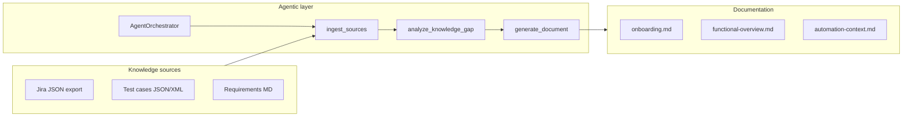

# AI Knowledge Documentation Framework (Use Case 3)

Agentic TypeScript framework for **AI-Based Induction & Knowledge Documentation Generation** — aligned to your 15-day POC goals:

| Business value | How this framework helps |
|----------------|---------------------------|
| Faster onboarding | Generates `onboarding.md` from Jira + tests + requirements |
| Less key-person dependency | Centralizes scattered artifacts into living docs |
| Up-to-date functional docs | `functional-overview.md` from stories and requirements |
| Better automation context | `automation-context.md` for AI-assisted TestNG/Selenium work |

## Architecture



**Framework packages**

| Layer | Path | Responsibility |
|-------|------|----------------|
| Facade | `src/KnowledgeDocAgent.ts` | Single entry for apps/CLI |
| Orchestration | `src/framework/AgentOrchestrator.ts` | LLM tool loop or deterministic POC pipeline |
| Tools | `src/tools/index.ts` | Ingest, gap analysis, document generation |
| Ingestion | `src/ingestion/ingest.ts` | Jira JSON, TestNG XML, markdown |
| Templates | `src/generators/templates.ts` | Markdown document builders |

## Quick start (POC, no API key)

```bash
cd ai-knowledge-framework
npm install
npm run agent -- --mock --app="Customer Portal" --out ./knowledge-output
```

This ingests `samples/` and writes three markdown files under `knowledge-output/`.

## Live agentic mode (optional)

Set `OPENAI_API_KEY` and run without `--mock`. The orchestrator uses the Vercel AI SDK tool-calling loop (`ingest_sources` → `analyze_knowledge_gap` → `generate_document`).

```bash
export OPENAI_API_KEY=sk-...
npm run agent -- --app="Customer Portal" \
  --out ./knowledge-output \
  samples/ ../MavenAutoTest/testng.xml
```

## Programmatic use

```typescript
import { KnowledgeDocAgent } from "@citest/ai-knowledge-framework";

const agent = new KnowledgeDocAgent({ mockLlm: true, outputDir: "./docs" });
const result = await agent.run({
  applicationName: "Customer Portal",
  sources: ["./samples", "../MavenAutoTest/testng.xml"],
  documentKinds: ["full-pack"],
  audience: "automation-engineer",
});
console.log(result.documents.map((d) => d.kind));
```

## 15-day POC rollout (suggested)

| Phase | Focus |
|-------|--------|
| Days 1–3 | Wire Jira export + existing TestNG/XML into `sources` |
| Days 4–7 | Run gap analysis; fix missing story↔test links |
| Days 8–11 | Tune templates / prompts for your Confluence style |
| Days 12–15 | Enable LLM mode; pilot with one squad; measure onboarding time |

## Java alternative

This repo’s `MavenAutoTest` module can invoke the CLI from a TestNG `@Test` or Maven `exec-maven-plugin` step. A full Java port can mirror the same tool names using LangChain4j or Spring AI; the TypeScript framework is the reference implementation for the POC.

## Related repo

- `MavenAutoTest/` — sample Selenium/TestNG project whose `testng.xml` can be ingested as a test artifact.
